# Food Guide 연동 화면 비교

사진 인식부터 Food Guide 이미지 API로 전환하고, 개인 비교·그룹 추천·수량 선택·오류 복구 화면을 함께 바꿨습니다. 아래 26개 사례는 **이전 → 이후** 순서의 실제 Streamlit 렌더링 캡처입니다. 운영 서비스에 배포했다는 의미는 아닙니다.

[나란히 보는 HTML 비교](compare.html) · [연동 계약과 구현 경계](../../foodguide-integration.md) · [캡처 사례 명세](../../../tests/visual/manifest.json)

## 비교 기준과 검증

- 이전 소스: `c9309485e3552c3be344d84d56fa79e3e281fe37`, 저장소 `core/data/demo_paris.json`의 16개 메뉴.
- 이후 소스: `7de2afa1356fb8433b825c925f1bab84d269105f`. 같은 공개 파리 메뉴판 사진과 `DEFAULT_PEOPLE`로 실제 Food Guide API를 호출해 저장한 응답을 사용합니다. 15개 메뉴가 `ok`, 그룹 메뉴는 3개였습니다.
- 이후 fixture: `tests/visual/fixtures/foodguide-paris.json`. 이 예시 1건은 연결 성공 근거이며 음식 추정·추천 정확도를 입증하지 않습니다. 동일 입력 사진이어도 이전 JSON과 이후 실제 응답의 메뉴 수·표현은 다릅니다.
- 식당을 먼저 선택하지 않으면 API 응답에 식당 이름이 없어 이후 제목은 “메뉴판”입니다. 이전 예시의 식당명을 새 결과에 임의로 넣지 않았습니다.
- 진행·실패 장면은 통제한 모의 응답을 **운영 UI 코드**에 연결한 상태입니다. 실제 지연·장애를 기록한 것이 아닙니다. 웹 출처 표시는 비교용 하네스 설정입니다.
- 기본 캡처는 430 × 932px입니다. 전체 화면 버전은 같은 430px 폭에서 viewport 높이를 늘려 촬영했습니다. 이미지 편집·생성 일러스트가 아닙니다.
- 메인 검증 결과: **156 passed in 1.45s**. 26개 전후 쌍·전체 캡처 104장의 파일·링크·해상도를 확인했고 주요 비교 화면을 시각 검토했습니다. [파일 검증 기록](verification.json)을 함께 보관합니다.

## 기능 의미의 변경

`all`·`local`·`fast` 세 조합은 모두 **하나의 API 그룹 추천**으로 연결됩니다. 이후 세 캡처가 같은 결과를 보이는 것은 의도한 동작입니다. 수량은 사람이 고릅니다. 8축 맛 지도, 조리시간·15분 보장, LLM 직원 예상 질문, 아이 전용 접시 제안은 API가 제공하지 않아 임의로 복원하지 않습니다.

선호 음식은 일부만 카탈로그 대표형에 연결될 수 있습니다. 화면은 연결 수와 미연결 음식·모호한 후보를 보여 주고, null 점수는 정보 부족으로 유지합니다. 전역 한식 유사도와 개인 선호 점수는 서로 다른 값이며 제한 조건 충족은 알레르기 안전 보장이 아닙니다. 좋아하는 맛·아이 식습관 등 미지원 설정도 안내합니다.

## 변경 화면 목록

| # | 사례 | 화면 | 구체적인 변경 |
|---|---|---|---|
| 1 | [people](#case-people) | 같이 먹는 사람 | 기존 사람 카드에 지난 비교의 선호 음식 연결 수를 표시합니다. 한 번에 비교할 활성 가족은 최대 6명입니다. |
| 2 | [edit-adult](#case-edit-adult) | 성인 입맛 편집 | 기존 즐겨 먹는 음식 선택을 유지하고 API 비교 기준 연결 상태를 보여 줍니다. 좋아하는 맛 등 API에 전달되지 않는 설정은 미반영 안내로 구분합니다. |
| 3 | [edit-child](#case-edit-child) | 아이 입맛 편집 | 아이 식습관 입력은 보존하지만 새 음식 반응·골라내는 재료·잘 먹는 재료가 API 점수에 반영되지 않음을 알립니다. 응답에 없는 아이 전용 조언을 만들지 않습니다. |
| 4 | [scan](#case-scan) | 사진 업로드 | 기존 OCR·Claude 메뉴 해석에서 Food Guide 이미지 API 제출로 바뀝니다. JPG·PNG·WebP 한 장, 15MB와 최대 20개 메뉴 제한을 안내합니다. |
| 5 | [menu-translated](#case-menu-translated) | 메뉴 목록 · 번역 | API가 반환한 음식명·가격·상태를 표시합니다. API가 식당 이름을 제공하지 않고 선택한 장소도 없어 새 제목은 “메뉴판”입니다. 이전 16개와 이후 15개는 서로 다른 분석 결과입니다. |
| 6 | [menu-original](#case-menu-original) | 메뉴 목록 · 원문 | 원문 이름·발음·가격을 API 인식 메타데이터로 연결합니다. 메뉴판 설명 원문을 한국어 번역인 것처럼 표시하지 않습니다. |
| 7 | [menu-people](#case-menu-people) | 메뉴 목록 · 개인 비교 | 이전 “누가 먹을까”의 편히·조심·피하기 판정을 개인별 API 점수·제한 조건과 기준 음식 연결 수로 바꿉니다. null 점수는 0점으로 치환하지 않습니다. |
| 8 | [dish](#case-dish) | 메뉴 상세 | 기존 좋아하는 음식 닮은꼴·추정 조언 대신 API의 전역 한식 유사도와 개인 선호 점수를 분리합니다. 주문에 담은 뒤 수량을 직접 정할 수 있습니다. |
| 9 | [dish-details](#case-dish-details) | 메뉴 상세 · 재료 펼침 | 기존 8축 맛 지도 대신 API가 반환한 맛·향·식감·주재료·양념·조리법을 표시합니다. 정보가 없는 항목은 추정값으로 채우지 않습니다. |
| 10 | [dish-allergy](#case-dish-allergy) | 제한 재료가 있는 메뉴 상세 | 조개류를 못 먹는 가족이 있는 홍합 메뉴를 비교합니다. 기존 강제 “피하기” 표시와 달리 API 제한 조건 결과·이유를 보여 주며 알레르기 안전 판정이 아님을 안내합니다. |
| 11 | [combo-all](#case-combo-all) | 조합 · 기존 모두 만족 | 기존 “모두 만족” 조합 화면을 API가 반환한 하나의 그룹 추천으로 교체합니다. 구성원별 메뉴 연결과 추천에 포함되지 못한 사람을 표시합니다. |
| 12 | [combo-local](#case-combo-local) | 조합 · 기존 현지 맛 도전 | 기존 “현지 맛 도전” 전용 조합은 별도로 만들지 않습니다. 이후 화면은 combo-all과 동일한 API 그룹 결과이며 공유 접시를 임의로 추가하지 않습니다. |
| 13 | [combo-fast](#case-combo-fast) | 조합 · 기존 빨리 나와요 | 기존 “빨리 나와요” 조합도 동일한 API 그룹으로 연결합니다. API에 없는 조리시간이나 “15분 안에” 추정치를 만들지 않습니다. |
| 14 | [order](#case-order) | 주문 카드 | 기존 조합 기반 자동 수량 대신 메뉴별 수량을 직접 고릅니다. 원문 메뉴·언어·가격을 기존 현지어 주문 카드에 연결하고 알레르기·못 먹는 것·요청 문구는 유지합니다. |
| 15 | [order-large](#case-order-large) | 주문 카드 · 큰 글씨 | 현지어 주문 카드의 큰 글씨 보기를 유지합니다. 선택 메뉴와 수량은 사용자가 결정하며 API에 없는 직원 예상 질문을 생성하지 않습니다. |
| 16 | [survey](#case-survey) | 식후 설문 | 실제 주문 여부·맛 설명·후기는 기존 저장 기능을 사용합니다. 저장된 후기가 현재 API 선호 점수를 변경하지 않는다는 안내를 추가합니다. |
| 17 | [simple-scan](#case-simple-scan) | 간단 모드 · 사진 | 링크로 지정된 한 사람만 비교하는 큰 글씨 흐름을 유지하면서 사진 제출을 Food Guide 이미지 API로 연결합니다. |
| 18 | [simple-menu](#case-simple-menu) | 간단 모드 · 메뉴 | 기존 판정별 메뉴 묶음 대신 선택한 한 사람의 API 점수·제한 조건·연결된 비교 기준 수를 보여 줍니다. |
| 19 | [simple-dish](#case-simple-dish) | 간단 모드 · 상세 | 한 사람 기준 상세에서도 전역 닮은 음식과 개인 점수를 구분합니다. 이전 맛 지도·추정 주문 팁을 API에 없는 값으로 재현하지 않습니다. |
| 20 | [simple-order-empty](#case-simple-order-empty) | 간단 모드 · 주문 전 | 아직 담은 메뉴가 없을 때 메뉴별 수량 선택을 펼쳐 보여 줍니다. 수량을 1개 이상 고르기 전에는 주문 카드를 만들지 않습니다. |
| 21 | [simple-order](#case-simple-order) | 간단 모드 · 선택 후 주문 | 선택한 메뉴를 큰 글씨 현지어 카드로 보여 주고 수량을 직접 조절하게 합니다. API가 인분을 추정하지 않습니다. |
| 22 | [simple-dish-avoid](#case-simple-dish-avoid) | 간단 모드 · 제한 재료 | 조개류를 못 먹는 아빠 한 사람의 결과입니다. 제한 조건과 이유를 확인하도록 안내하며 낮은 점수·미확인·안전성을 같은 의미로 취급하지 않습니다. |
| 23 | [edit-parent](#case-edit-parent) | 부모님 입맛 · 대표형 선택 | 갈비찜처럼 대표형이 여러 개인 음식은 후보를 직접 고르게 합니다. 고른 후보도 이후 수정·해제할 수 있고, 미연결 음식은 삭제하거나 닮은 다른 음식으로 바꾸지 않습니다. |
| 24 | [menu-web](#case-menu-web) | 웹에서 찾은 메뉴 | 기존 웹 메뉴 검색과 출처 링크를 유지하고 설명 생성 단계는 Food Guide 텍스트 API로 바꿉니다. 화면의 출처 표시는 하네스에서 설정한 비교 조건이며 새 실시간 웹 검색의 증거는 아닙니다. |
| 25 | [processing](#case-processing) | 분석 진행 중 | 이전 일반 읽기 상태에서 API 단계별 메시지·진행률로 바뀝니다. 이 캡처는 실제 운영 UI에 통제한 대기 응답을 넣은 장면이며 실제 서버 처리시간의 증거가 아닙니다. |
| 26 | [provider-error](#case-provider-error) | 분석 실패·재요청 | 기존 사진 읽기 실패 안내와 새 분석 실패·명시적 새 작업 요청 흐름을 비교합니다. 예시 성공 결과로 자동 전환하지 않습니다. 장애 응답은 통제한 모의 상태이며 실제 운영 장애가 아닙니다. |

## 이전 → 이후

<a id="case-people"></a>
<details>
<summary>01. 같이 먹는 사람 — people</summary>

기존 사람 카드에 지난 비교의 선호 음식 연결 수를 표시합니다. 한 번에 비교할 활성 가족은 최대 6명입니다.

<table>
<tr><th>이전 · BEFORE</th><th>→</th><th>이후 · AFTER</th></tr>
<tr><td><a href="before/people.png">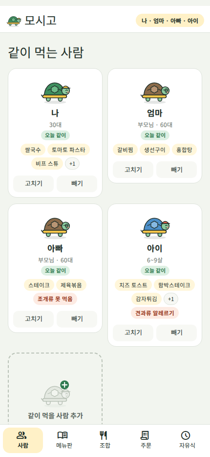</a></td><td>→</td><td><a href="after/people.png">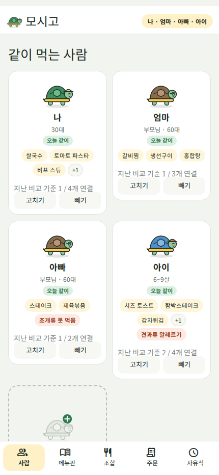</a></td></tr>
<tr><td><a href="before/full/people.png">이전 전체 화면</a></td><td>→</td><td><a href="after/full/people.png">이후 전체 화면</a></td></tr>
</table>

</details>

<a id="case-edit-adult"></a>
<details>
<summary>02. 성인 입맛 편집 — edit-adult</summary>

기존 즐겨 먹는 음식 선택을 유지하고 API 비교 기준 연결 상태를 보여 줍니다. 좋아하는 맛 등 API에 전달되지 않는 설정은 미반영 안내로 구분합니다.

<table>
<tr><th>이전 · BEFORE</th><th>→</th><th>이후 · AFTER</th></tr>
<tr><td><a href="before/edit-adult.png"></a></td><td>→</td><td><a href="after/edit-adult.png">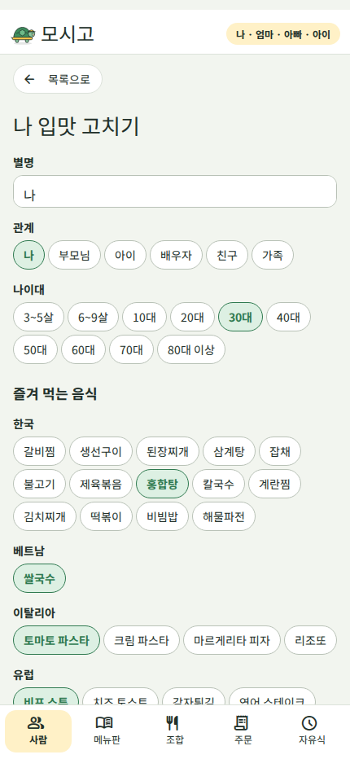</a></td></tr>
<tr><td><a href="before/full/edit-adult.png">이전 전체 화면</a></td><td>→</td><td><a href="after/full/edit-adult.png">이후 전체 화면</a></td></tr>
</table>

</details>

<a id="case-edit-child"></a>
<details>
<summary>03. 아이 입맛 편집 — edit-child</summary>

아이 식습관 입력은 보존하지만 새 음식 반응·골라내는 재료·잘 먹는 재료가 API 점수에 반영되지 않음을 알립니다. 응답에 없는 아이 전용 조언을 만들지 않습니다.

<table>
<tr><th>이전 · BEFORE</th><th>→</th><th>이후 · AFTER</th></tr>
<tr><td><a href="before/edit-child.png"></a></td><td>→</td><td><a href="after/edit-child.png">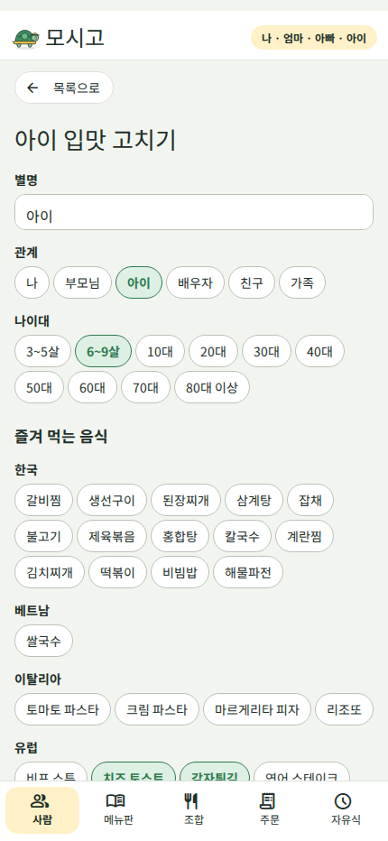</a></td></tr>
<tr><td><a href="before/full/edit-child.png">이전 전체 화면</a></td><td>→</td><td><a href="after/full/edit-child.png">이후 전체 화면</a></td></tr>
</table>

</details>

<a id="case-scan"></a>
<details>
<summary>04. 사진 업로드 — scan</summary>

기존 OCR·Claude 메뉴 해석에서 Food Guide 이미지 API 제출로 바뀝니다. JPG·PNG·WebP 한 장, 15MB와 최대 20개 메뉴 제한을 안내합니다.

<table>
<tr><th>이전 · BEFORE</th><th>→</th><th>이후 · AFTER</th></tr>
<tr><td><a href="before/scan.png">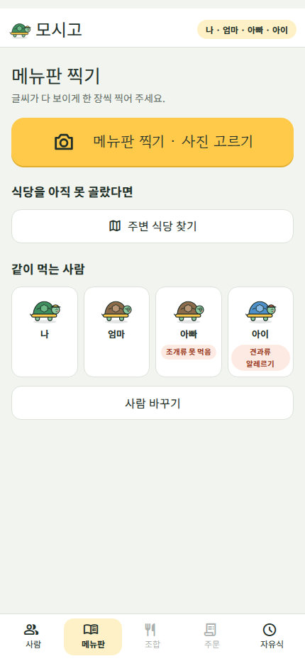</a></td><td>→</td><td><a href="after/scan.png">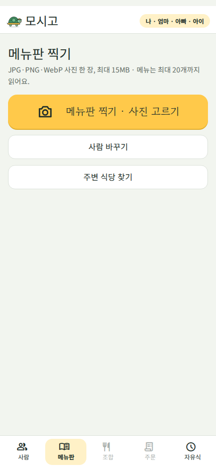</a></td></tr>
<tr><td><a href="before/full/scan.png">이전 전체 화면</a></td><td>→</td><td><a href="after/full/scan.png">이후 전체 화면</a></td></tr>
</table>

</details>

<a id="case-menu-translated"></a>
<details>
<summary>05. 메뉴 목록 · 번역 — menu-translated</summary>

API가 반환한 음식명·가격·상태를 표시합니다. API가 식당 이름을 제공하지 않고 선택한 장소도 없어 새 제목은 “메뉴판”입니다. 이전 16개와 이후 15개는 서로 다른 분석 결과입니다.

<table>
<tr><th>이전 · BEFORE</th><th>→</th><th>이후 · AFTER</th></tr>
<tr><td><a href="before/menu-translated.png">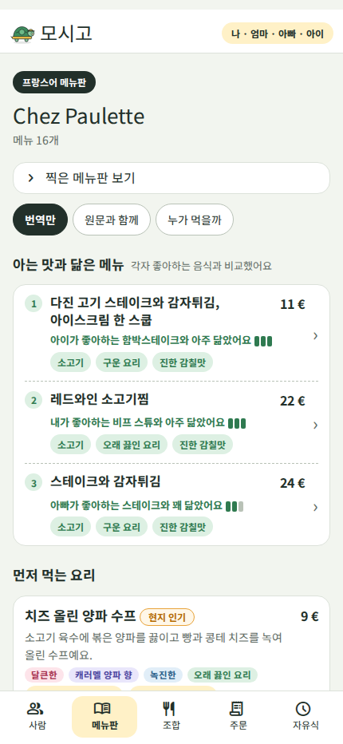</a></td><td>→</td><td><a href="after/menu-translated.png">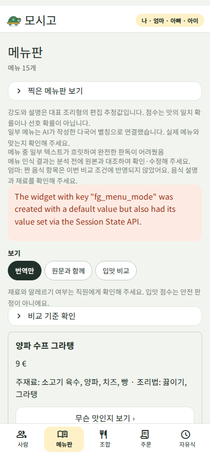</a></td></tr>
<tr><td><a href="before/full/menu-translated.png">이전 전체 화면</a></td><td>→</td><td><a href="after/full/menu-translated.png">이후 전체 화면</a></td></tr>
</table>

</details>

<a id="case-menu-original"></a>
<details>
<summary>06. 메뉴 목록 · 원문 — menu-original</summary>

원문 이름·발음·가격을 API 인식 메타데이터로 연결합니다. 메뉴판 설명 원문을 한국어 번역인 것처럼 표시하지 않습니다.

<table>
<tr><th>이전 · BEFORE</th><th>→</th><th>이후 · AFTER</th></tr>
<tr><td><a href="before/menu-original.png">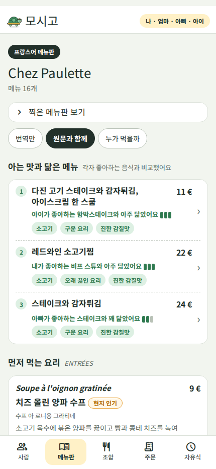</a></td><td>→</td><td><a href="after/menu-original.png">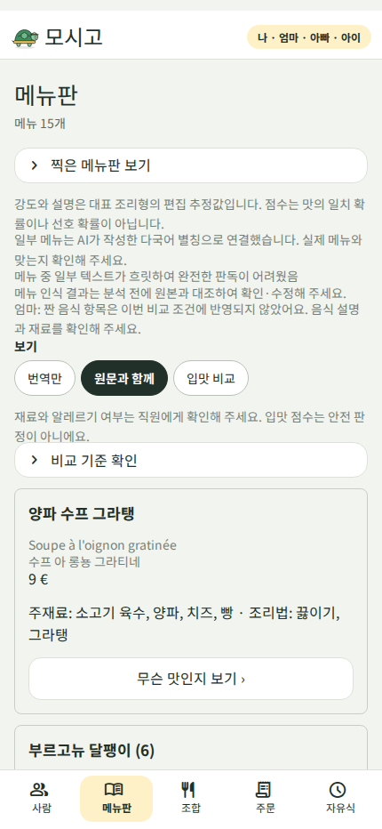</a></td></tr>
<tr><td><a href="before/full/menu-original.png">이전 전체 화면</a></td><td>→</td><td><a href="after/full/menu-original.png">이후 전체 화면</a></td></tr>
</table>

</details>

<a id="case-menu-people"></a>
<details>
<summary>07. 메뉴 목록 · 개인 비교 — menu-people</summary>

이전 “누가 먹을까”의 편히·조심·피하기 판정을 개인별 API 점수·제한 조건과 기준 음식 연결 수로 바꿉니다. null 점수는 0점으로 치환하지 않습니다.

<table>
<tr><th>이전 · BEFORE</th><th>→</th><th>이후 · AFTER</th></tr>
<tr><td><a href="before/menu-people.png">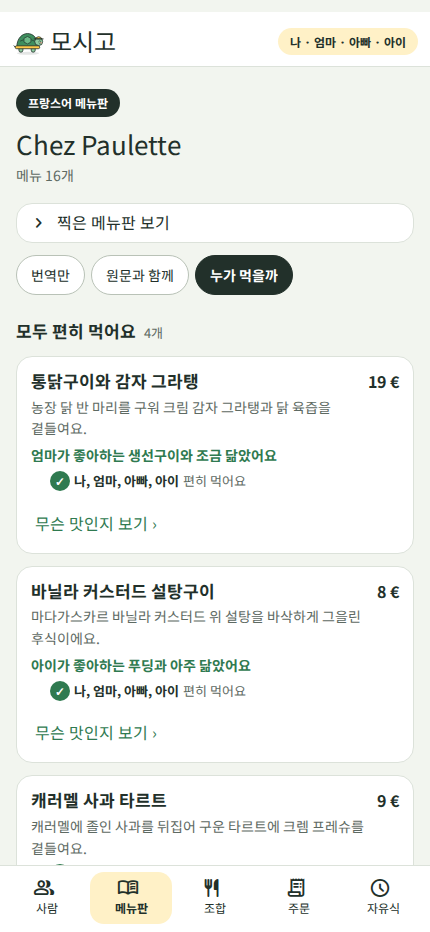</a></td><td>→</td><td><a href="after/menu-people.png">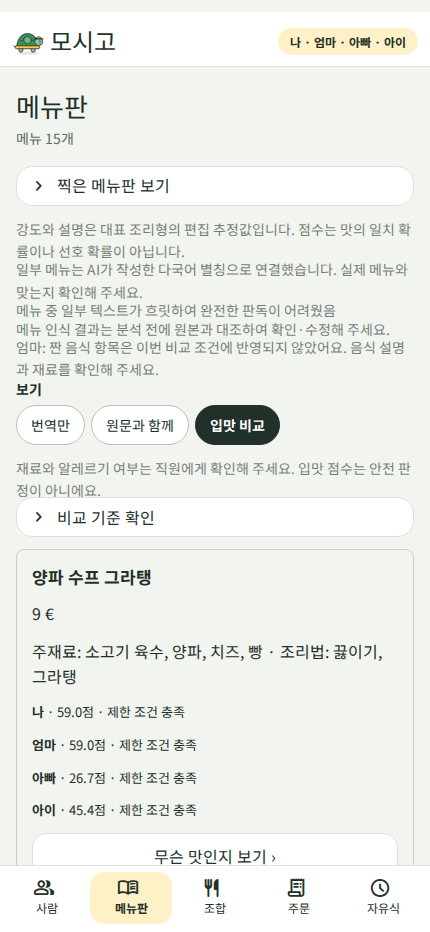</a></td></tr>
<tr><td><a href="before/full/menu-people.png">이전 전체 화면</a></td><td>→</td><td><a href="after/full/menu-people.png">이후 전체 화면</a></td></tr>
</table>

</details>

<a id="case-dish"></a>
<details>
<summary>08. 메뉴 상세 — dish</summary>

기존 좋아하는 음식 닮은꼴·추정 조언 대신 API의 전역 한식 유사도와 개인 선호 점수를 분리합니다. 주문에 담은 뒤 수량을 직접 정할 수 있습니다.

<table>
<tr><th>이전 · BEFORE</th><th>→</th><th>이후 · AFTER</th></tr>
<tr><td><a href="before/dish.png">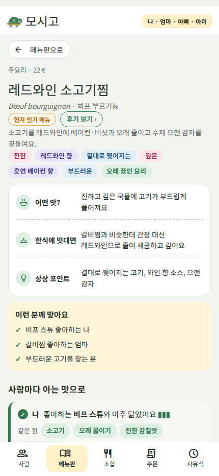</a></td><td>→</td><td><a href="after/dish.png">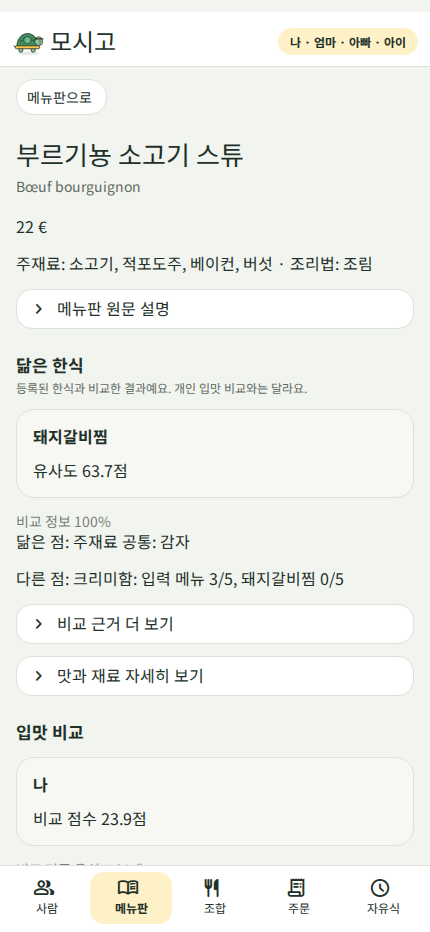</a></td></tr>
<tr><td><a href="before/full/dish.png">이전 전체 화면</a></td><td>→</td><td><a href="after/full/dish.png">이후 전체 화면</a></td></tr>
</table>

</details>

<a id="case-dish-details"></a>
<details>
<summary>09. 메뉴 상세 · 재료 펼침 — dish-details</summary>

기존 8축 맛 지도 대신 API가 반환한 맛·향·식감·주재료·양념·조리법을 표시합니다. 정보가 없는 항목은 추정값으로 채우지 않습니다.

<table>
<tr><th>이전 · BEFORE</th><th>→</th><th>이후 · AFTER</th></tr>
<tr><td><a href="before/dish-details.png"></a></td><td>→</td><td><a href="after/dish-details.png">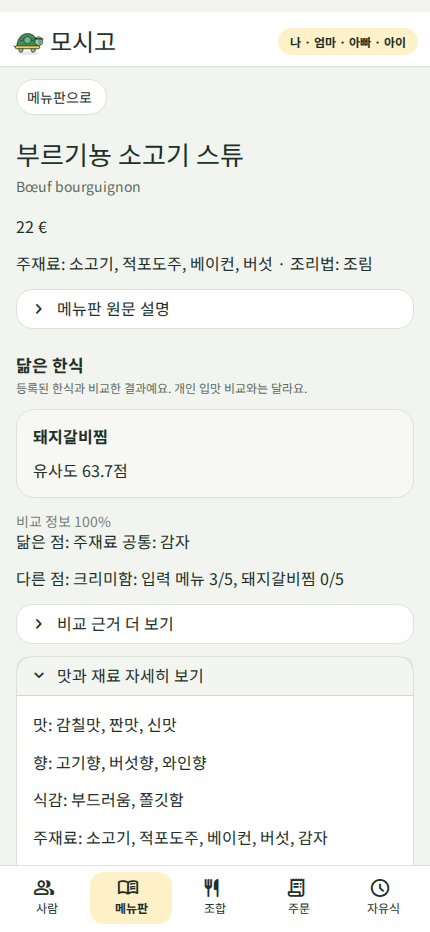</a></td></tr>
<tr><td><a href="before/full/dish-details.png">이전 전체 화면</a></td><td>→</td><td><a href="after/full/dish-details.png">이후 전체 화면</a></td></tr>
</table>

</details>

<a id="case-dish-allergy"></a>
<details>
<summary>10. 제한 재료가 있는 메뉴 상세 — dish-allergy</summary>

조개류를 못 먹는 가족이 있는 홍합 메뉴를 비교합니다. 기존 강제 “피하기” 표시와 달리 API 제한 조건 결과·이유를 보여 주며 알레르기 안전 판정이 아님을 안내합니다.

<table>
<tr><th>이전 · BEFORE</th><th>→</th><th>이후 · AFTER</th></tr>
<tr><td><a href="before/dish-allergy.png">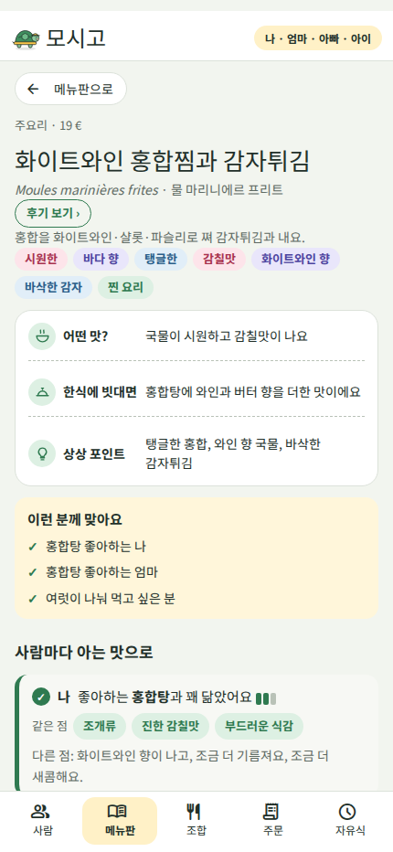</a></td><td>→</td><td><a href="after/dish-allergy.png">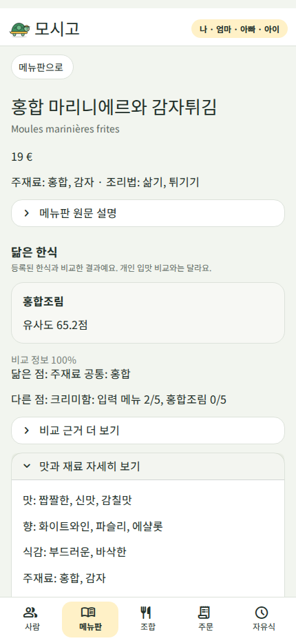</a></td></tr>
<tr><td><a href="before/full/dish-allergy.png">이전 전체 화면</a></td><td>→</td><td><a href="after/full/dish-allergy.png">이후 전체 화면</a></td></tr>
</table>

</details>

<a id="case-combo-all"></a>
<details>
<summary>11. 조합 · 기존 모두 만족 — combo-all</summary>

기존 “모두 만족” 조합 화면을 API가 반환한 하나의 그룹 추천으로 교체합니다. 구성원별 메뉴 연결과 추천에 포함되지 못한 사람을 표시합니다.

<table>
<tr><th>이전 · BEFORE</th><th>→</th><th>이후 · AFTER</th></tr>
<tr><td><a href="before/combo-all.png">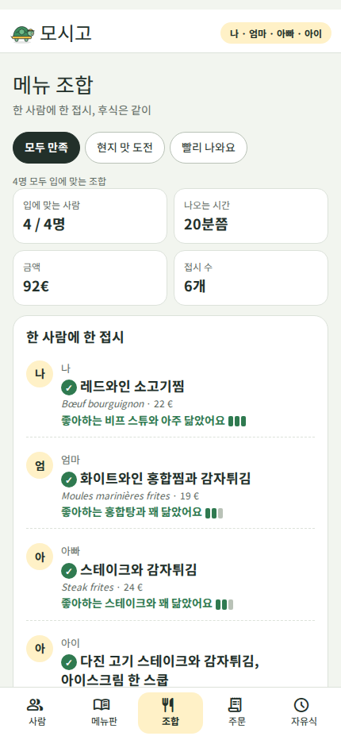</a></td><td>→</td><td><a href="after/combo-all.png"></a></td></tr>
<tr><td><a href="before/full/combo-all.png">이전 전체 화면</a></td><td>→</td><td><a href="after/full/combo-all.png">이후 전체 화면</a></td></tr>
</table>

</details>

<a id="case-combo-local"></a>
<details>
<summary>12. 조합 · 기존 현지 맛 도전 — combo-local</summary>

기존 “현지 맛 도전” 전용 조합은 별도로 만들지 않습니다. 이후 화면은 combo-all과 동일한 API 그룹 결과이며 공유 접시를 임의로 추가하지 않습니다.

<table>
<tr><th>이전 · BEFORE</th><th>→</th><th>이후 · AFTER</th></tr>
<tr><td><a href="before/combo-local.png">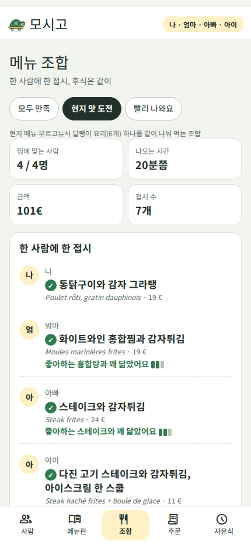</a></td><td>→</td><td><a href="after/combo-local.png"></a></td></tr>
<tr><td><a href="before/full/combo-local.png">이전 전체 화면</a></td><td>→</td><td><a href="after/full/combo-local.png">이후 전체 화면</a></td></tr>
</table>

</details>

<a id="case-combo-fast"></a>
<details>
<summary>13. 조합 · 기존 빨리 나와요 — combo-fast</summary>

기존 “빨리 나와요” 조합도 동일한 API 그룹으로 연결합니다. API에 없는 조리시간이나 “15분 안에” 추정치를 만들지 않습니다.

<table>
<tr><th>이전 · BEFORE</th><th>→</th><th>이후 · AFTER</th></tr>
<tr><td><a href="before/combo-fast.png">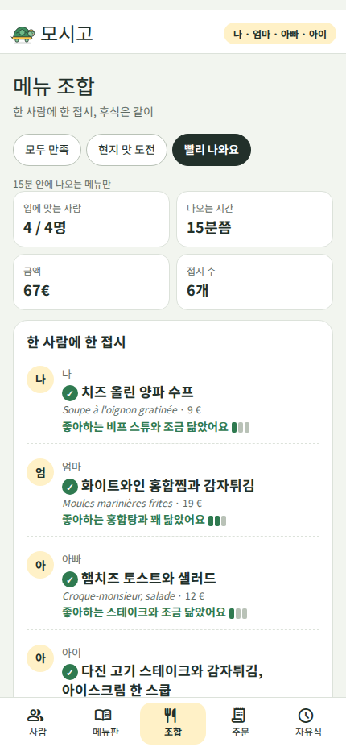</a></td><td>→</td><td><a href="after/combo-fast.png">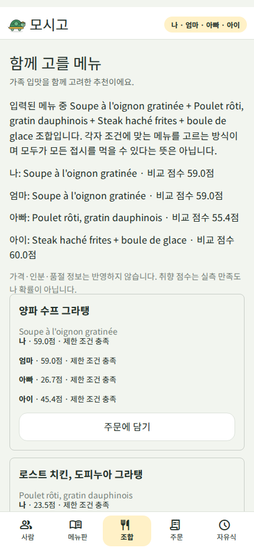</a></td></tr>
<tr><td><a href="before/full/combo-fast.png">이전 전체 화면</a></td><td>→</td><td><a href="after/full/combo-fast.png">이후 전체 화면</a></td></tr>
</table>

</details>

<a id="case-order"></a>
<details>
<summary>14. 주문 카드 — order</summary>

기존 조합 기반 자동 수량 대신 메뉴별 수량을 직접 고릅니다. 원문 메뉴·언어·가격을 기존 현지어 주문 카드에 연결하고 알레르기·못 먹는 것·요청 문구는 유지합니다.

<table>
<tr><th>이전 · BEFORE</th><th>→</th><th>이후 · AFTER</th></tr>
<tr><td><a href="before/order.png">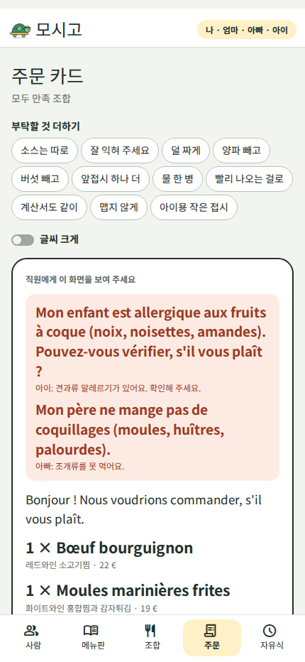</a></td><td>→</td><td><a href="after/order.png">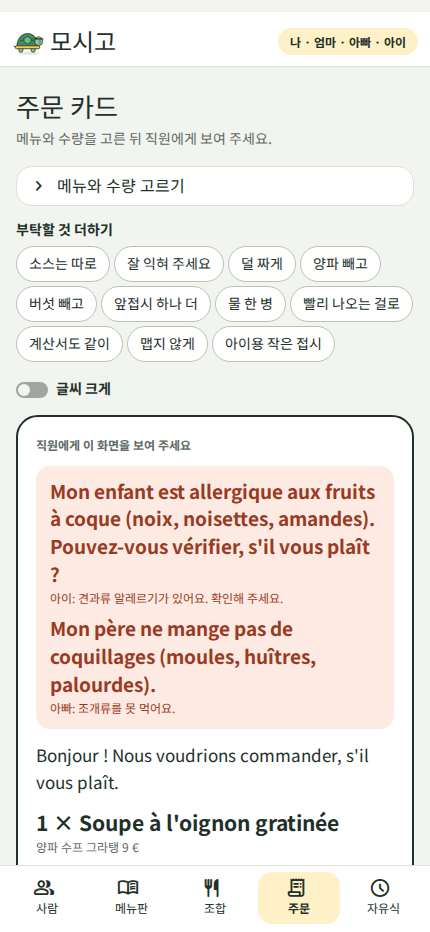</a></td></tr>
<tr><td><a href="before/full/order.png">이전 전체 화면</a></td><td>→</td><td><a href="after/full/order.png">이후 전체 화면</a></td></tr>
</table>

</details>

<a id="case-order-large"></a>
<details>
<summary>15. 주문 카드 · 큰 글씨 — order-large</summary>

현지어 주문 카드의 큰 글씨 보기를 유지합니다. 선택 메뉴와 수량은 사용자가 결정하며 API에 없는 직원 예상 질문을 생성하지 않습니다.

<table>
<tr><th>이전 · BEFORE</th><th>→</th><th>이후 · AFTER</th></tr>
<tr><td><a href="before/order-large.png">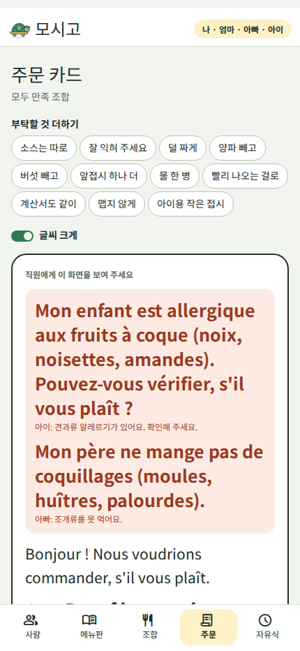</a></td><td>→</td><td><a href="after/order-large.png">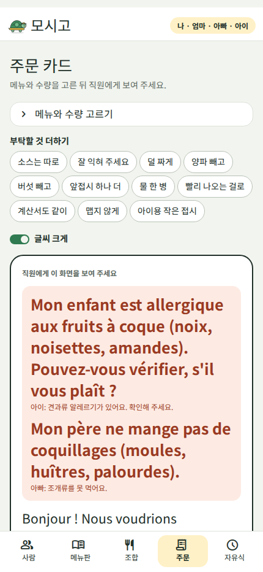</a></td></tr>
<tr><td><a href="before/full/order-large.png">이전 전체 화면</a></td><td>→</td><td><a href="after/full/order-large.png">이후 전체 화면</a></td></tr>
</table>

</details>

<a id="case-survey"></a>
<details>
<summary>16. 식후 설문 — survey</summary>

실제 주문 여부·맛 설명·후기는 기존 저장 기능을 사용합니다. 저장된 후기가 현재 API 선호 점수를 변경하지 않는다는 안내를 추가합니다.

<table>
<tr><th>이전 · BEFORE</th><th>→</th><th>이후 · AFTER</th></tr>
<tr><td><a href="before/survey.png">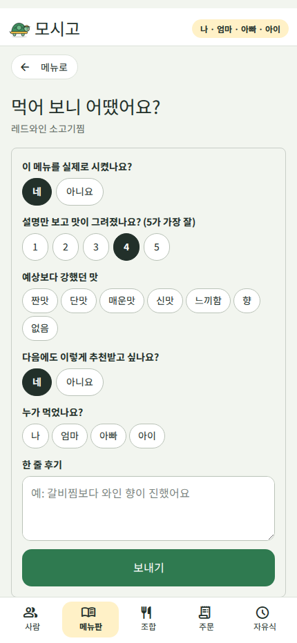</a></td><td>→</td><td><a href="after/survey.png">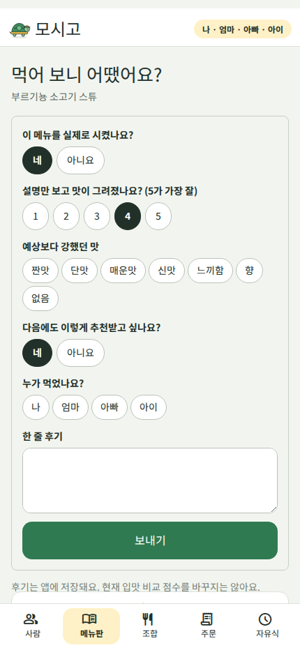</a></td></tr>
<tr><td><a href="before/full/survey.png">이전 전체 화면</a></td><td>→</td><td><a href="after/full/survey.png">이후 전체 화면</a></td></tr>
</table>

</details>

<a id="case-simple-scan"></a>
<details>
<summary>17. 간단 모드 · 사진 — simple-scan</summary>

링크로 지정된 한 사람만 비교하는 큰 글씨 흐름을 유지하면서 사진 제출을 Food Guide 이미지 API로 연결합니다.

<table>
<tr><th>이전 · BEFORE</th><th>→</th><th>이후 · AFTER</th></tr>
<tr><td><a href="before/simple-scan.png">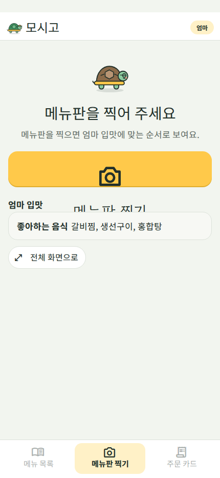</a></td><td>→</td><td><a href="after/simple-scan.png">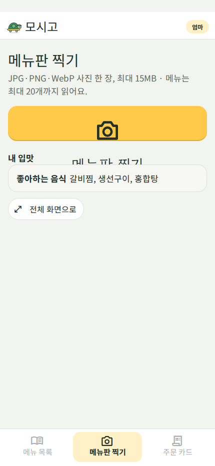</a></td></tr>
<tr><td><a href="before/full/simple-scan.png">이전 전체 화면</a></td><td>→</td><td><a href="after/full/simple-scan.png">이후 전체 화면</a></td></tr>
</table>

</details>

<a id="case-simple-menu"></a>
<details>
<summary>18. 간단 모드 · 메뉴 — simple-menu</summary>

기존 판정별 메뉴 묶음 대신 선택한 한 사람의 API 점수·제한 조건·연결된 비교 기준 수를 보여 줍니다.

<table>
<tr><th>이전 · BEFORE</th><th>→</th><th>이후 · AFTER</th></tr>
<tr><td><a href="before/simple-menu.png">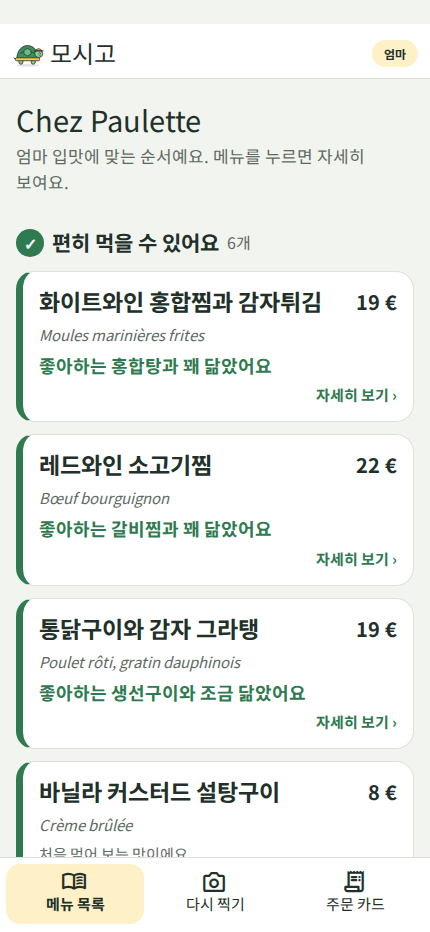</a></td><td>→</td><td><a href="after/simple-menu.png">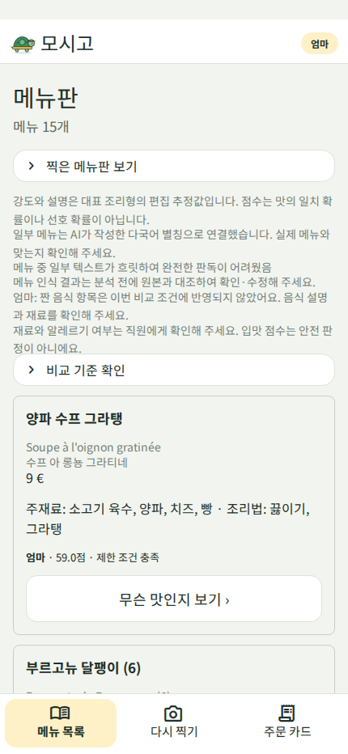</a></td></tr>
<tr><td><a href="before/full/simple-menu.png">이전 전체 화면</a></td><td>→</td><td><a href="after/full/simple-menu.png">이후 전체 화면</a></td></tr>
</table>

</details>

<a id="case-simple-dish"></a>
<details>
<summary>19. 간단 모드 · 상세 — simple-dish</summary>

한 사람 기준 상세에서도 전역 닮은 음식과 개인 점수를 구분합니다. 이전 맛 지도·추정 주문 팁을 API에 없는 값으로 재현하지 않습니다.

<table>
<tr><th>이전 · BEFORE</th><th>→</th><th>이후 · AFTER</th></tr>
<tr><td><a href="before/simple-dish.png">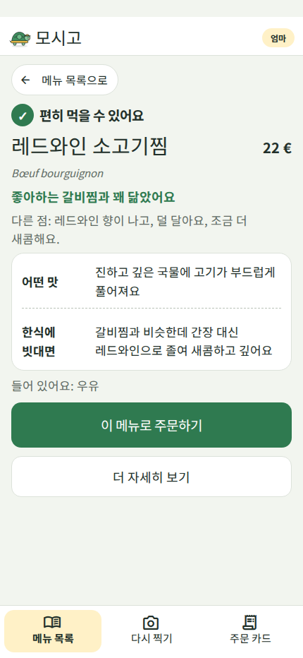</a></td><td>→</td><td><a href="after/simple-dish.png">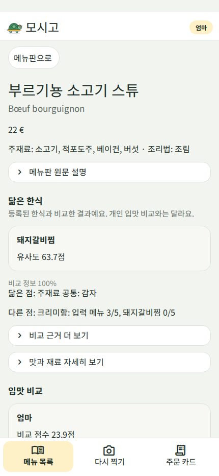</a></td></tr>
<tr><td><a href="before/full/simple-dish.png">이전 전체 화면</a></td><td>→</td><td><a href="after/full/simple-dish.png">이후 전체 화면</a></td></tr>
</table>

</details>

<a id="case-simple-order-empty"></a>
<details>
<summary>20. 간단 모드 · 주문 전 — simple-order-empty</summary>

아직 담은 메뉴가 없을 때 메뉴별 수량 선택을 펼쳐 보여 줍니다. 수량을 1개 이상 고르기 전에는 주문 카드를 만들지 않습니다.

<table>
<tr><th>이전 · BEFORE</th><th>→</th><th>이후 · AFTER</th></tr>
<tr><td><a href="before/simple-order-empty.png">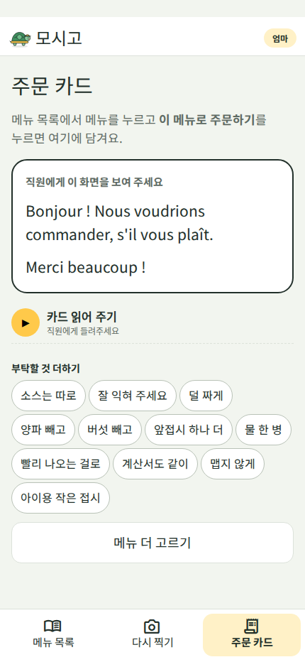</a></td><td>→</td><td><a href="after/simple-order-empty.png">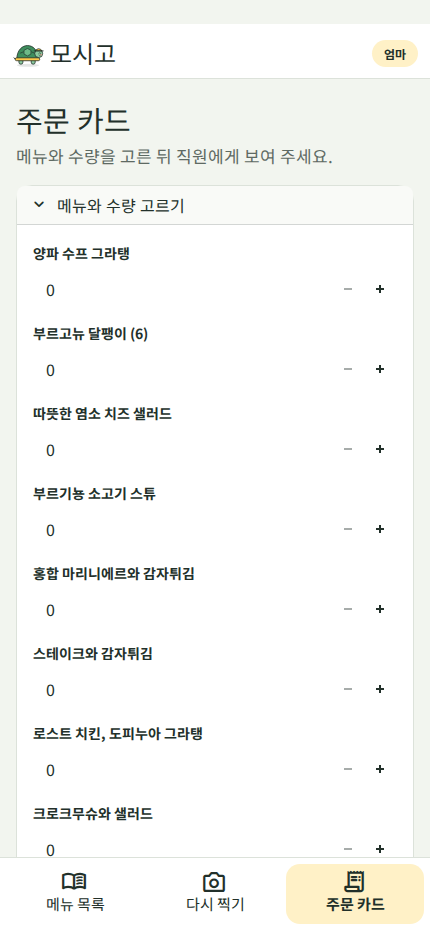</a></td></tr>
<tr><td><a href="before/full/simple-order-empty.png">이전 전체 화면</a></td><td>→</td><td><a href="after/full/simple-order-empty.png">이후 전체 화면</a></td></tr>
</table>

</details>

<a id="case-simple-order"></a>
<details>
<summary>21. 간단 모드 · 선택 후 주문 — simple-order</summary>

선택한 메뉴를 큰 글씨 현지어 카드로 보여 주고 수량을 직접 조절하게 합니다. API가 인분을 추정하지 않습니다.

<table>
<tr><th>이전 · BEFORE</th><th>→</th><th>이후 · AFTER</th></tr>
<tr><td><a href="before/simple-order.png">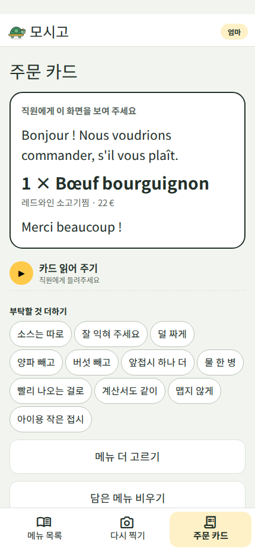</a></td><td>→</td><td><a href="after/simple-order.png">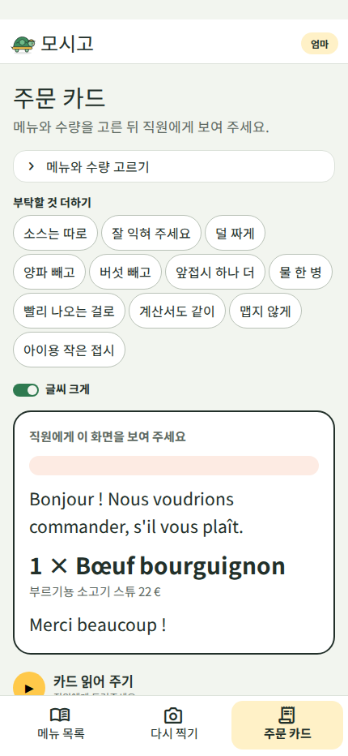</a></td></tr>
<tr><td><a href="before/full/simple-order.png">이전 전체 화면</a></td><td>→</td><td><a href="after/full/simple-order.png">이후 전체 화면</a></td></tr>
</table>

</details>

<a id="case-simple-dish-avoid"></a>
<details>
<summary>22. 간단 모드 · 제한 재료 — simple-dish-avoid</summary>

조개류를 못 먹는 아빠 한 사람의 결과입니다. 제한 조건과 이유를 확인하도록 안내하며 낮은 점수·미확인·안전성을 같은 의미로 취급하지 않습니다.

<table>
<tr><th>이전 · BEFORE</th><th>→</th><th>이후 · AFTER</th></tr>
<tr><td><a href="before/simple-dish-avoid.png">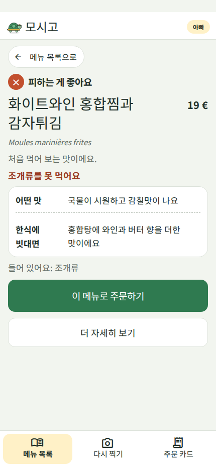</a></td><td>→</td><td><a href="after/simple-dish-avoid.png">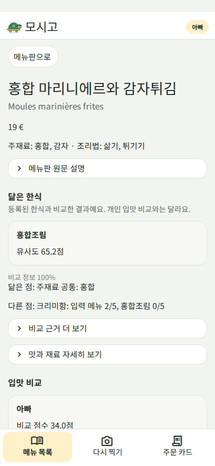</a></td></tr>
<tr><td><a href="before/full/simple-dish-avoid.png">이전 전체 화면</a></td><td>→</td><td><a href="after/full/simple-dish-avoid.png">이후 전체 화면</a></td></tr>
</table>

</details>

<a id="case-edit-parent"></a>
<details>
<summary>23. 부모님 입맛 · 대표형 선택 — edit-parent</summary>

갈비찜처럼 대표형이 여러 개인 음식은 후보를 직접 고르게 합니다. 고른 후보도 이후 수정·해제할 수 있고, 미연결 음식은 삭제하거나 닮은 다른 음식으로 바꾸지 않습니다.

<table>
<tr><th>이전 · BEFORE</th><th>→</th><th>이후 · AFTER</th></tr>
<tr><td><a href="before/edit-parent.png">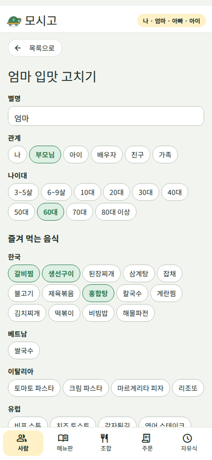</a></td><td>→</td><td><a href="after/edit-parent.png"></a></td></tr>
<tr><td><a href="before/full/edit-parent.png">이전 전체 화면</a></td><td>→</td><td><a href="after/full/edit-parent.png">이후 전체 화면</a></td></tr>
</table>

</details>

<a id="case-menu-web"></a>
<details>
<summary>24. 웹에서 찾은 메뉴 — menu-web</summary>

기존 웹 메뉴 검색과 출처 링크를 유지하고 설명 생성 단계는 Food Guide 텍스트 API로 바꿉니다. 화면의 출처 표시는 하네스에서 설정한 비교 조건이며 새 실시간 웹 검색의 증거는 아닙니다.

<table>
<tr><th>이전 · BEFORE</th><th>→</th><th>이후 · AFTER</th></tr>
<tr><td><a href="before/menu-web.png">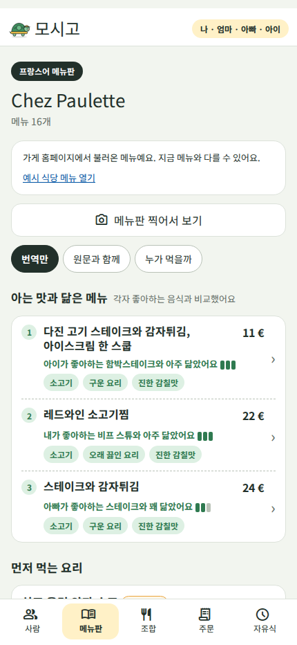</a></td><td>→</td><td><a href="after/menu-web.png">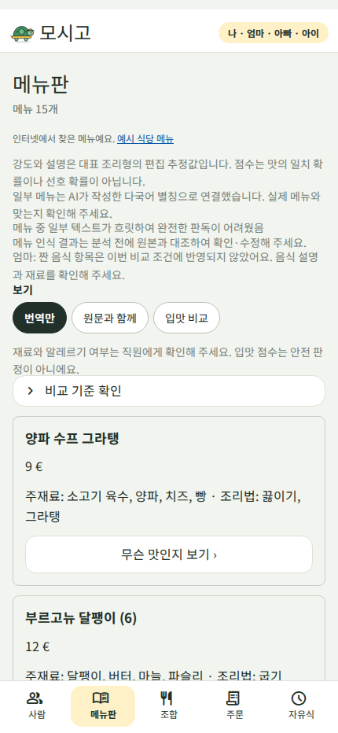</a></td></tr>
<tr><td><a href="before/full/menu-web.png">이전 전체 화면</a></td><td>→</td><td><a href="after/full/menu-web.png">이후 전체 화면</a></td></tr>
</table>

</details>

<a id="case-processing"></a>
<details>
<summary>25. 분석 진행 중 — processing</summary>

이전 일반 읽기 상태에서 API 단계별 메시지·진행률로 바뀝니다. 이 캡처는 실제 운영 UI에 통제한 대기 응답을 넣은 장면이며 실제 서버 처리시간의 증거가 아닙니다.

<table>
<tr><th>이전 · BEFORE</th><th>→</th><th>이후 · AFTER</th></tr>
<tr><td><a href="before/processing.png">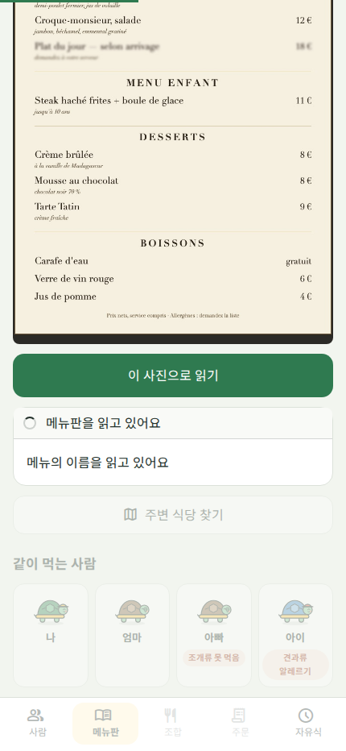</a></td><td>→</td><td><a href="after/processing.png">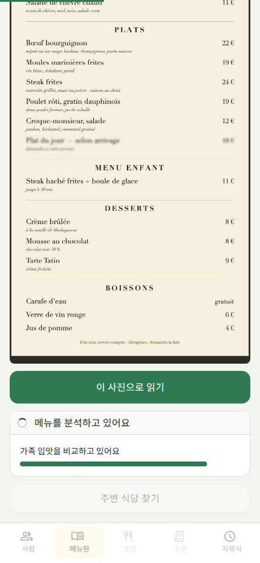</a></td></tr>
<tr><td><a href="before/full/processing.png">이전 전체 화면</a></td><td>→</td><td><a href="after/full/processing.png">이후 전체 화면</a></td></tr>
</table>

</details>

<a id="case-provider-error"></a>
<details>
<summary>26. 분석 실패·재요청 — provider-error</summary>

기존 사진 읽기 실패 안내와 새 분석 실패·명시적 새 작업 요청 흐름을 비교합니다. 예시 성공 결과로 자동 전환하지 않습니다. 장애 응답은 통제한 모의 상태이며 실제 운영 장애가 아닙니다.

<table>
<tr><th>이전 · BEFORE</th><th>→</th><th>이후 · AFTER</th></tr>
<tr><td><a href="before/provider-error.png">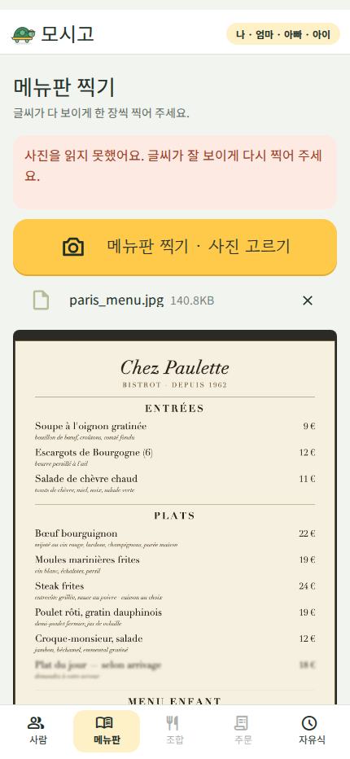</a></td><td>→</td><td><a href="after/provider-error.png">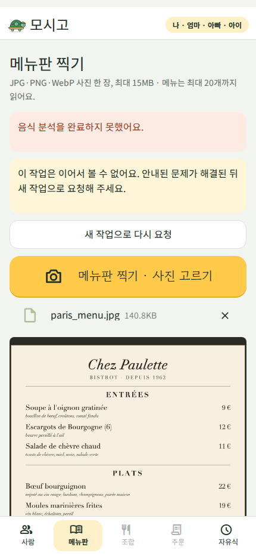</a></td></tr>
<tr><td><a href="before/full/provider-error.png">이전 전체 화면</a></td><td>→</td><td><a href="after/full/provider-error.png">이후 전체 화면</a></td></tr>
</table>

</details>

## 재현

작업 저장소 루트에서 실행합니다. baseline 경로는 이전 커밋을 체크아웃한 별도 디렉터리이며 after 경로는 위 이후 소스입니다. 하네스와 브라우저 도구는 현재 작업 저장소의 파일을 사용합니다. 캡처는 저장된 fixture·모의 상태를 사용하므로 실제 API를 다시 호출하지 않습니다.

```sh
cd tests/visual
npm ci --ignore-scripts
npx playwright install chromium  # Chromium이 캐시에 없을 때만
cd ../..
```

두 터미널에서 각각 화면 서버를 시작합니다.

```sh
MOSHIGO_SNAPSHOT=1 MOSHIGO_CAPTURE_ROOT=/absolute/baseline streamlit run scripts/visual_snapshot_app.py --server.address 127.0.0.1 --server.port 8502
```

```sh
MOSHIGO_SNAPSHOT=1 MOSHIGO_CAPTURE_ROOT=/absolute/after streamlit run scripts/visual_snapshot_app.py --server.address 127.0.0.1 --server.port 8503
```

작업 저장소 루트의 별도 터미널에서 캡처합니다. `MOSHIGO_CAPTURE_ROOT`는 캡처 메타데이터에 기록할 소스와도 일치시킵니다.

```sh
MOSHIGO_CAPTURE_ROOT=/absolute/baseline node tests/visual/capture.mjs before
MOSHIGO_CAPTURE_ROOT=/absolute/after node tests/visual/capture.mjs after
```

결과 위치는 `docs/changes/foodguide/{before,after}/`이며 전체 화면은 각각 `full/` 아래에 있습니다. 캡처 메타데이터 JSON에는 소스 커밋·fixture·viewport·브라우저 오류가 기록됩니다. 이 디렉터리를 통째로 유지하면 Markdown·HTML의 상대 이미지 링크가 함께 동작합니다.
