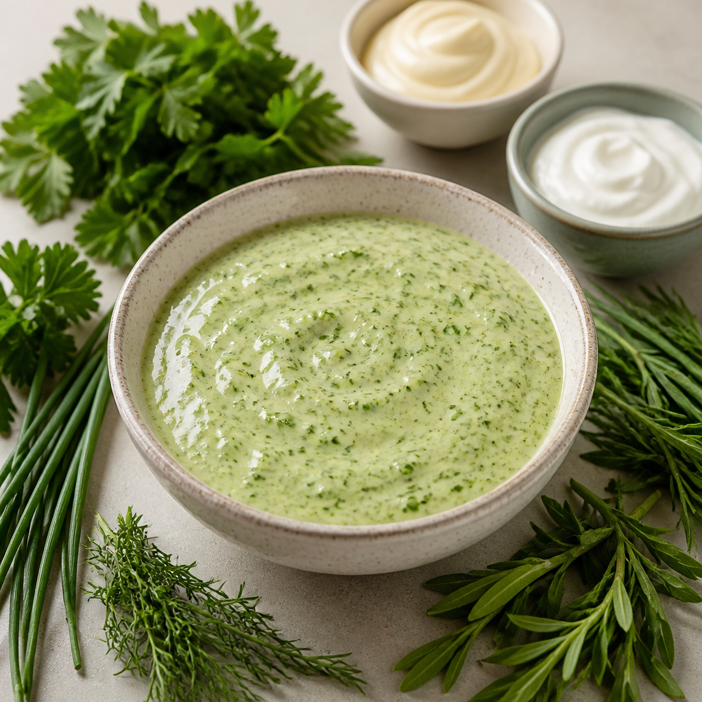
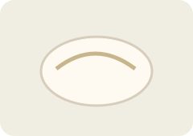
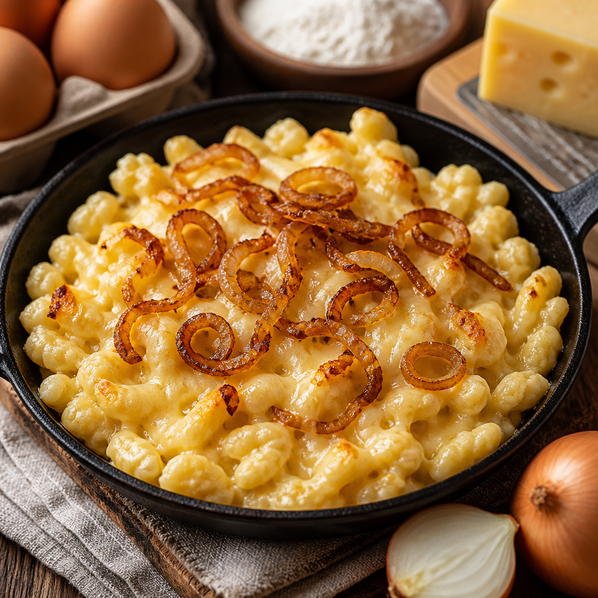

# 상위 두 메뉴의 OpenAI 생성 이미지

현재는 [새 메뉴판 자동 이미지 생성](../automatic-images/README.md)을 사용합니다. 이 문서는 수동 생성 시범·식사류 필터 적용 전 기록입니다. 현재 추천은 [식사류 우선 추천](../meal-recommendations/README.md)을 확인하세요.

현재 평균 추천 순위 상위 두 메뉴인 **그뤼네 소스·케스페츨레**만 생성해 저장했습니다. 생성 파일을 소비 앱에 포함하고, 해당 음식 설명과 일치하면서 현재 추천 상위 두 개에 들어가는 카드에만 표시합니다. 카드의 `추정 통화` 문구는 제거했습니다. 통화 판단 근거는 접힌 가격 정보에 보존합니다.

| 메뉴 | 변경 전 | → 변경 후 |
|---|---|---|
| 그뤼네 소스 |  |  |
| 알고이어 케스페츨레 |  |  |

- 이미지 생성은 사용자 OpenAI API 키가 설정된 기존 Food Guide `stage3.generate_food_image()`를 재사용했습니다. 소비 앱·브라우저에 OpenAI 키를 추가하지 않았습니다.
- 모델: `gpt-image-2-2026-04-21`, 1024×1024 PNG, low quality, 각 메뉴 1장. 기존 설정 `gpt-image-1`의 두 요청은 API 오류였으며, 지원 모델 조회 후 위 모델로 각각 한 장씩 성공했습니다. 초기 실패 기록은 manifest에 보존합니다.
- 음식명·재료·조리법만 생성에 사용했습니다. 가족 정보·제한 조건·사용자 사진을 이미지 API에 전송하지 않았습니다. 사진은 실제 매장 음식이 아닌 `AI 생성 이미지`로 표시합니다.
- 렌더링은 로컬 파일만 읽습니다. 다른 메뉴나 새 상위 메뉴의 이미지를 자동으로 유료 생성하지 않습니다. 새 음식 생성은 1~2개를 선택해 실행하는 현재 초기 범위입니다.
- 생성 전 pending 기록, 기존 호출 한도 예약, SDK 자동 재시도 없음, 원자적 파일 저장 및 PNG·SHA-256 검증을 적용했습니다. 같은 요청을 다시 실행해 두 결과 모두 `reused`이며 추가 생성 호출이 없음을 확인했습니다.
- 검증: 자산 모듈 16개·UI 회귀 41개 통과. 실제 Chrome에서 총 19개 카드 중 생성 이미지 정확히 2개, `추정 통화` 0개, 두 이미지의 1024px 로딩 완료를 확인했습니다.

[생성 기록·파일 해시](../../../core/data/generated-menu-images/manifest.json) · [정제된 재현 입력](../../../core/data/generated-menu-images/request.json) · [프롬프트](../../../core/data/generated-menu-images/README.md)
