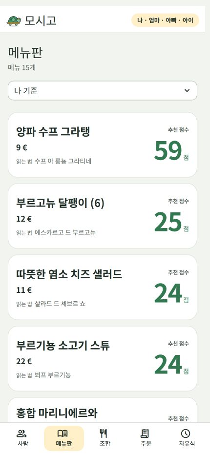
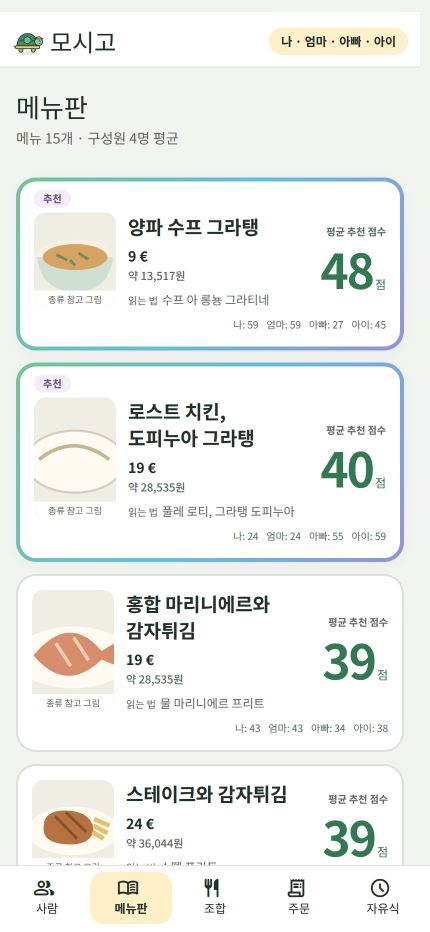
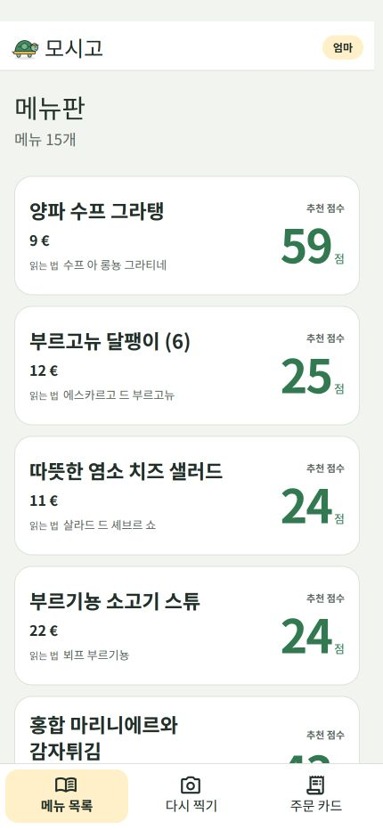
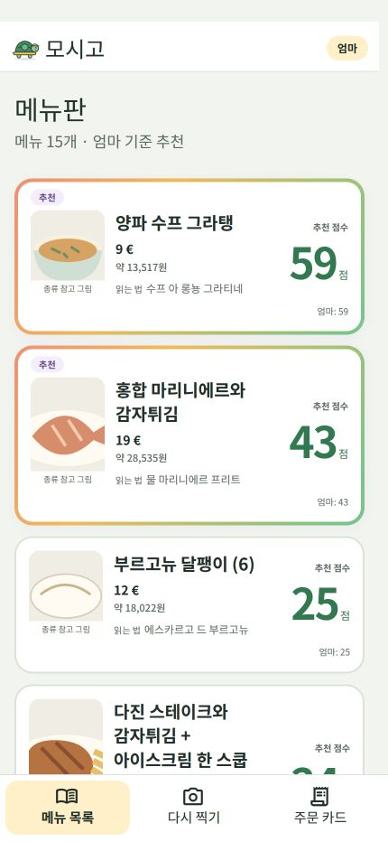

# 추천 메뉴 강조·이미지·통화 환산

최신 추가 변경은 [상위 두 메뉴의 생성 이미지 적용](../generated-top-menus/README.md)입니다. 아래는 생성 이미지 적용 전 기록입니다.

메뉴별 **활성 구성원 전체의 평균 추천 점수**에 따라 정렬하고 상위 두 개를 맨 위에 표시합니다. 추천 카드는 **4px 무지개 테두리·4초 색 전환·좌측 상단 추천 배지**로 강조합니다. 모션 감소 설정에서는 움직이지 않습니다.

- 기준 선택 상자를 제거했습니다. 일반 모드는 활성 구성원 전원의 산술 평균, 간단 모드는 링크 대상자의 점수를 사용합니다. 기준과 인원수는 목록 제목 아래에 표시합니다.
- 개인별 원점수의 평균을 반올림하기 전에 정렬합니다. 동점은 원래 순서입니다. 한 명이라도 제한·정보 부족이 있거나 결과가 오래됐으면 큰 숫자와 추천 배지에서 제외합니다. 해당 사람을 분모에서 빼서 평균을 높이지 않습니다. 0점은 유효한 점수입니다.
- 카드에는 음식 이미지, 메뉴명, 통화가 포함된 원문 가격, 원화 참고 금액, 읽는 법, 큰 평균 추천 점수와 구성원별 작은 점수를 표시합니다. 제한된 구성원의 작은 점수에는 `제한`을 함께 표시합니다.
- 사진은 메뉴판의 음식 사진 영역 → 라이선스를 확인한 대표 사진 → 종류 참고 그림 순서입니다. 이 실행 환경에서는 Wikimedia API가 403을 반환해 실제 대표 사진을 확보하지 못했습니다. 현재 예시·실제 화면은 종류 참고 그림이며 실제 매장 음식 사진으로 표시하지 않습니다. [이미지 출처·처리 기록](../../dish-image-sources.md)
- 통화는 사용자가 매번 고르지 않습니다. Food Guide 이미지 인식에서 코드·기호와 메뉴 맥락을 함께 판단합니다. 추정이면 `추정 통화`, 불확실하면 환산을 생략합니다. AI가 코드 필드를 비워 두고 추정 근거에 하나의 ISO 코드만 명시한 경우 그 코드를 복구합니다. 언어를 국가·통화로 직접 대응시키지 않습니다.
- 원화는 Frankfurter v2의 일별 기준 환율을 한 시간 캐시해 계산합니다. 기준일·출처·사진 저작권은 목록 아래 `가격·사진 정보`에 있습니다. 환율 실패·복합 가격·미확인 통화에 가짜 원화 값을 만들지 않습니다. [환율 계약](../../menu-prices.md)
- 사진을 다시 선택하거나 저장된 사진으로 다시 분석할 수 있습니다. 진행 중 작업은 재개하고 완료된 작업만 명시적으로 새로 요청합니다. 동일 사진의 OCR은 API의 기존 한 시간 캐시를 사용할 수 있습니다.

## 일반 메뉴 목록

| 변경 전 | → | 변경 후 |
|---|---|---|
|  | → |  |

## 간단 모드

| 변경 전 | → | 변경 후 |
|---|---|---|
|  | → |  |

## API 적용

통화 인식은 별도로 운영하는 Food Guide API의 `extraction.currency_code`, `currency_source`, `currency_evidence` 선택 필드를 사용합니다. 기존 응답도 호환되며 가격에 명시된 통화는 계속 처리합니다.

현재 PC API에는 변경을 적용했습니다. 다른 서버에서 사용하려면 [API 변경 패치](../../api-patches/currency-extraction.patch)를 해당 저장소에 적용하고 배포하세요. 이 패치는 `foodguide/stage1.py`와 `foodguide/api_models.py`만 변경하며 새 모델 호출·엔드포인트·인증키를 추가하지 않습니다. 스키마를 재생성하면 OpenAPI에도 세 필드가 표시됩니다. 운영 Render 앱에 배포한 것은 아닙니다.

## 검증

- 최종 평균 점수 UI 회귀: **39 passed**. 모든 활성 구성원 포함, 평균에 따른 순위 역전, 소수점·동점 순서, 누락·제한 인원을 빼서 평균을 부풀리지 않는지, 원본 배열 보존을 검증했습니다.
- 평균 변경 직전 UI·흐름 회귀: **61 passed in 1.99s**. 상세 이동, 저장 사진 재분석, 통화 복구 및 입맛 재비교 후 통화 보존을 검증했습니다.
- API 추출·계약: **65 passed**. 기존 이미지 분석 호출 안에서 필드가 추출·직렬화되는지 검증했습니다.
- 음식 이미지 모듈: **24 passed**. 환율 모듈도 관련 가격·통화·429·캐시·자동 통화 복구 검사가 통과했습니다.
- 실제 Chrome의 19개 메뉴에서 추천 두 개, 음식 그림, 개인별 점수, 유로 추정과 원화 환산을 확인했습니다. `14,90 EUR`는 2026-11-04 기준 **약 22,377원**입니다. 이 개인 화면과 업로드 사진은 저장소에 게시하지 않았습니다.
- 위 전후 이미지는 공개 파리 fixture를 사용한 430×932px Streamlit 캡처입니다. 환율은 같은 날짜의 검증값으로 고정하고 이미지 조회는 차단해 참고 그림을 사용했습니다. 360px 화면에서 카드 가로 넘침 0개·추천 배지 2개를 확인했습니다.
