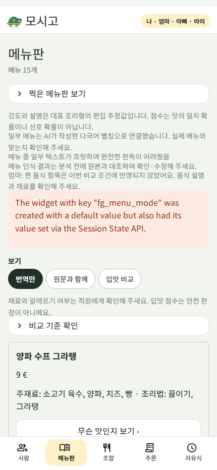
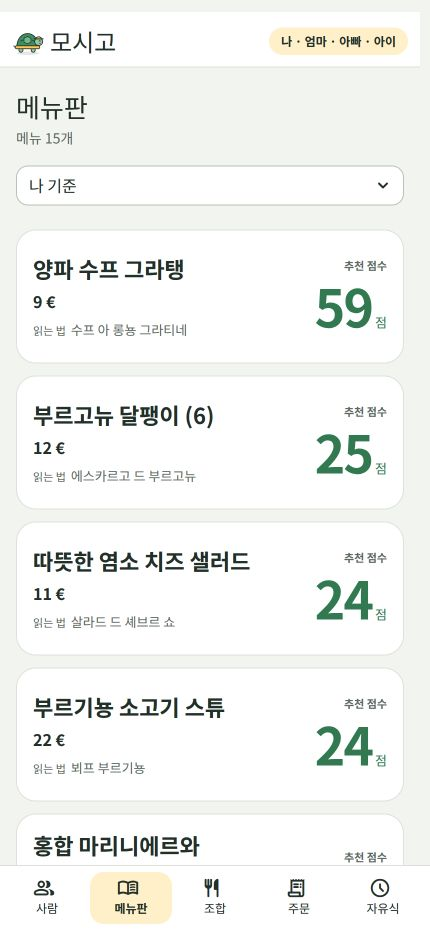
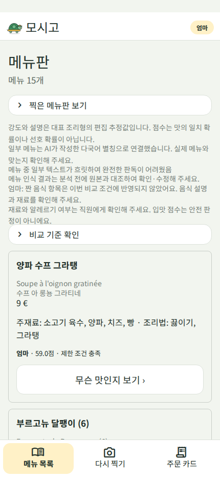
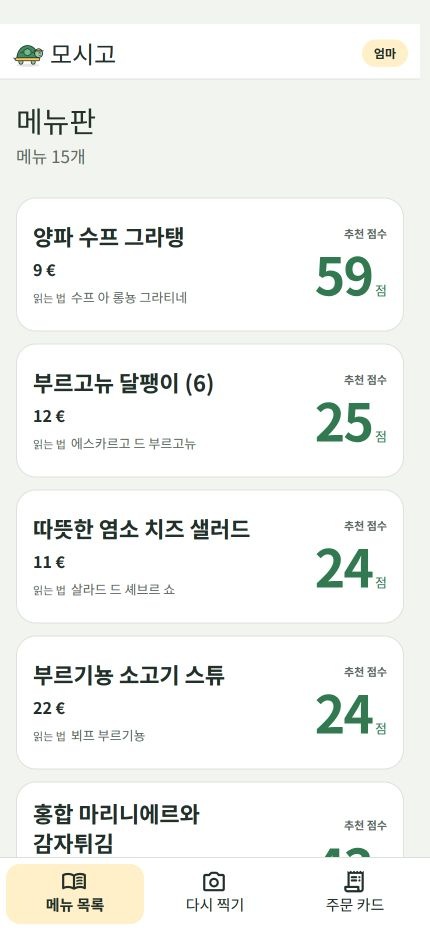

# 메뉴 목록 간소화

이후 변경은 [추천 강조·이미지·원화 환산 비교](../menu-recommendations/README.md)를 확인하세요. 아래는 중간 단계 기록입니다.

메뉴를 고르기 전에 긴 설명과 보기 전환을 읽어야 했던 목록을, **큰 추천 점수·메뉴명·가격·읽는 법**만 있는 카드로 바꿨습니다.

- 여러 사람은 상단에서 점수 기준을 고릅니다. 선택은 상세 화면에 갔다 돌아와도 유지됩니다.
- 점수는 선택한 사람의 API 개인 비교 점수를 정수로 반올림한 표시값입니다. 평균이나 전역 한식 유사도로 대체하지 않습니다.
- 점수가 없거나 정보가 부족하면 `—`, 제한 조건을 충족하지 못하면 `— / 제한 확인`을 표시합니다. 0점은 유효한 0점으로 보존합니다.
- 카드 전체를 누르면 상세로 이동합니다. 사진·출처·분석 안내·비교 기준은 상세의 접힌 `분석 정보`에 모았습니다.
- 메뉴 원래 순서·분석 결과·요청 방식은 유지합니다.

## 일반 메뉴 목록

| 변경 전 | → | 변경 후 |
|---|---|---|
|  | → |  |

## 간단 모드

| 변경 전 | → | 변경 후 |
|---|---|---|
|  | → |  |

## 확인

- 공개 예시 사진·API 응답 fixture는 최초 API 연동 비교와 같습니다. 사용자가 실제로 사용 중인 개인 화면은 이 문서에 게시하지 않았습니다.
- 이전 이미지는 `8e631cb`의 API 연동 화면, 이후 이미지는 수정된 실제 Streamlit 화면입니다. 양쪽 모두 430×932px입니다.
- UI 회귀 23개 통과(1.63초). 상세 진입 후 기준 사람 유지 수정 뒤 해당 회귀도 통과(1개, 0.76초).
- 실제 Chrome에서도 기존 19개 분석 결과를 유지한 채 목록 전환·제한 표시·상세 이동을 확인했습니다. API 재호출이나 서버 재시작은 하지 않았습니다.
